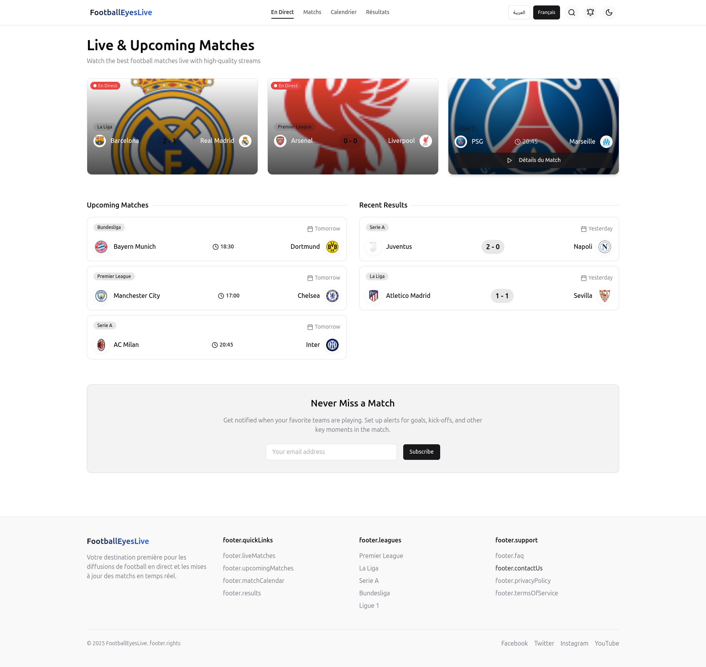

# FootballEyesLive

FootballEyesLive is a web application designed for fans to watch live football matches, stay updated on upcoming fixtures, and check out recent results. It offers a sleek and user-friendly interface for live match streaming, match schedules, and more.

## Features

- **Live Matches**: Watch football matches live with high-quality streams.
- **Upcoming Matches**: Get details on upcoming matches across different leagues and competitions.
- **Recent Results**: Check the latest match results from various leagues and competitions.
- **Match Alerts**: Set up notifications to never miss a match or important events like goals, kick-offs, and key moments.
- **Multilingual Support**: Available in different languages including English and French.

## Technologies

- **Frontend**:
  - React.js
  - Tailwind CSS
  - Lucide React (for icons)
  - Vite for fast builds
- **Backend**:
  - Node.js
  - REST API (for fetching live data)
- **Others**:
  - Vercel for hosting
  - Unsplash for stock images

## Installation

To run the project locally, follow these steps:

1. Clone the repository:
   ```bash
   git clone <repository-url>
   ```

2. Navigate to the project directory:
   ```bash
   cd FootballEyesLive
   ```

3. Install dependencies:
   ```bash
   npm install
   ```

4. Start the development server:
   ```bash
   npm run dev
   ```

The application will be accessible at `http://localhost:8080`.

## Configuration

Make sure to configure your environment to support the following:

- **Vite**: Make sure your local setup is compatible with Vite.
- **API Key**: If you are using an external service for live match data, make sure to include your API keys in the `.env` file.

## Screenshots



## Footer Links

- **Quick Links**: 
  - Live Matches
  - Upcoming Matches
  - Results
  - Calendar
- **Leagues**:
  - Premier League
  - La Liga
  - Serie A
  - Bundesliga
  - Ligue 1
- **Support**:
  - FAQ
  - Contact Us
  - Privacy Policy
  - Terms of Service

## Contributing

If you'd like to contribute to the development of FootballEyesLive, feel free to fork the repository and create pull requests with improvements or bug fixes.

## License

Distributed under the MIT License. See `LICENSE` for more information.

## Footer

```
© 2025 MOUYAHADA Ismail. All rights reserved.
```
 

## Deploy

[](https://vercel.com/new/clone?repository-url=https%3A%2F%2Fgithub.com%2Fghostland-dev%2Ffootballeyes-live)

Click the button to deploy your own copy on Vercel in one step.

## Author

**Ismail.M**, Software Engineer & DevOps

- GitHub: [@ghostland-dev](https://github.com/ghostland-dev)
- Website: [ismail-mouyahada.com](https://www.ismail-mouyahada.com)
